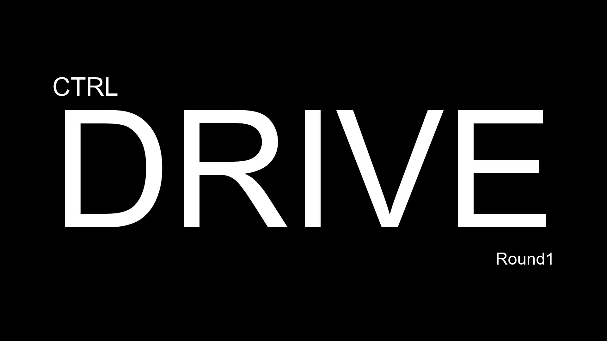
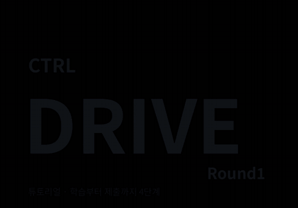

<p align="center">
  
</p>

# CTRL DRIVE — Round 1

**AI가 운전하는 탑뷰 레이스 대회.**
센서 값 12개를 보고 `[핸들, 엑셀]`을 내는 에이전트를 만들어 제출하면,
**처음 보는 비공개 트랙**에서 달려서 순위를 매깁니다.

## 🎬 튜토리얼

<p align="center">
  
</p>

학습 → 평가 → 주행 영상 확인 → 제출까지 4단계. 고화질 영상: [`assets/tutorial.mp4`](assets/tutorial.mp4)

## ⚡ 빠른 시작

### 코랩 (설치 없이)
[`starter/train_colab.ipynb`](starter/train_colab.ipynb) 를 코랩에서 열고 위에서부터 실행하면 끝.

### 내 컴퓨터
```bash
git clone https://github.com/jeehoo0507/CTRL-Drive.git
cd CTRL-Drive/round1
pip install -r requirements.txt

python starter/evaluate.py                      # 기본 예시 에이전트 점수 보기
python starter/train_numpy.py                   # 학습 (numpy만 사용, 30만 스텝 ≈ 3~5분)
python starter/evaluate.py                      # 내 에이전트 점수
python starter/watch.py --out replay.mp4        # 주행 영상
```

## 📦 제출물

`Agent` 클래스 하나만 있으면 됩니다. 안에 뭐가 들었는지(신경망, if문, 유전 알고리즘…)는 자유.

```python
class Agent:
    def __init__(self):
        # 가중치 로드 등 (한 번만 실행)
        ...

    def act(self, obs):
        # 매 프레임 호출: 관측 12개 → [steer, throttle]
        return [steer, throttle]          # 둘 다 -1 ~ 1
```

`agent.py` + 필요한 파일(가중치 등)을 **zip 하나**로 묶어서 제출.

```bash
cd starter && zip ../submission.zip agent.py weights.npz
```

> 평가 환경에는 `numpy` 만 있다고 가정해 주세요. 예시 `agent.py` 처럼 학습은 PyTorch로 해도
> 가중치를 numpy로 저장해서 쓰면 안전합니다.

## 👀 관측 (`obs`, 12개)

| idx | 내용 | 범위 |
|---|---|---|
| 0–8 | 레이캐스트 9개: 차 기준 -90° ~ +90° 방향으로 벽까지 거리 / 300 | 0 ~ 1 |
| 9 | 속도 / 최대속도 | -0.2 ~ 1 |
| 10 | 100px 앞 트랙 중심선 방향 - 차 방향 (/π) | -1 ~ 1 |
| 11 | 250px 앞 트랙 중심선 방향 - 차 방향 (/π) | -1 ~ 1 |

**행동**: `[steer, throttle]` — steer: -1 왼쪽 ~ +1 오른쪽 / throttle: +1 가속, 음수 브레이크(멈춰 있으면 후진)

## 🏁 규칙과 채점

- 트랙 밖(벽)으로 나가면 **즉시 종료**, 3초 동안 앞으로 못 가면 종료, 최대 60초
- 빠를수록 덜 꺾임 (횡가속 한계) → **코너 전에 감속**해야 함
- 출발 위치/방향이 시드마다 살짝 다름 → 외우기 불가
- 점수 (트랙 × 시드 평균)
  - 완주: `100 + (60 - 기록초)`
  - 미완주: `진행률 × 100`
- **채점은 비공개 트랙**에서 합니다. 연습 트랙 3개(`oval`, `hairpin`, `chicane`)만 외우면 망해요.
- `starter/evaluate.py` 는 대회 서버와 **같은 채점 코드**(`racegame/scoring.py`)를 씁니다. 다른 건 트랙뿐.

## 🗂️ 구조

```
round1/
├── racegame/                 게임 엔진 (수정 X, 채점도 이걸로 함)
│   ├── track.py              트랙: 중심선 + 폭 → 벽, 진행도
│   ├── car.py                차 물리 (자전거 모델)
│   ├── sensors.py            레이캐스트 → 관측
│   ├── env.py                reset() / step(), 규칙
│   ├── scoring.py            공식 채점
│   ├── render.py             영상
│   ├── gym_wrapper.py        Gymnasium 어댑터 (Stable-Baselines3 등에 바로 연결)
│   └── tracks/               연습 트랙 3개
├── starter/
│   ├── agent.py              제출 템플릿 (예시 가중치 weights.npz 포함)
│   ├── train_numpy.py        numpy로 짠 PPO (설치 가벼움, 코드 다 보임)
│   ├── train.py              Stable-Baselines3 PPO (코랩 권장)
│   ├── evaluate.py           로컬 채점
│   ├── watch.py              주행 영상 저장
│   ├── train_colab.ipynb     코랩 원클릭
│   └── examples/rule_based/  신경망 없이 if문만으로 만든 에이전트
└── assets/
```

## 💡 팁

- **보상을 바꿔보세요.** `train_numpy.py` 의 `rew[i] = r - 0.01` 한 줄이 학습 방향을 정합니다.
- **연습 트랙을 늘리세요.** 트랙은 json 파일(`racegame/tracks/*/track.json`)이라 제어점만 찍으면 새로 만들 수 있어요.
  처음 보는 트랙에 강한 에이전트가 이깁니다.
- **영상을 꼭 보세요.** 점수만 보면 어디서 왜 망했는지 모릅니다.
- 학습할 땐 `env.track`, `env.car` 같은 **게임 내부 정보를 마음껏 써도 됩니다** (보상 설계, 모방학습용 선생님 등).
  제출한 `Agent` 는 `obs` 만 받는다는 것만 지키면 돼요.

## ❓ FAQ

- **GPU 필요?** 아니요. 관측이 작아서 CPU로 충분합니다.
- **PyTorch 써도 돼요?** 학습엔 OK. 제출할 땐 numpy로 돌아가게 하는 걸 권장합니다 (예시 `agent.py` 참고).
- **`act` 시간 제한?** 프레임당 수 ms 안에 끝나게 해주세요.
